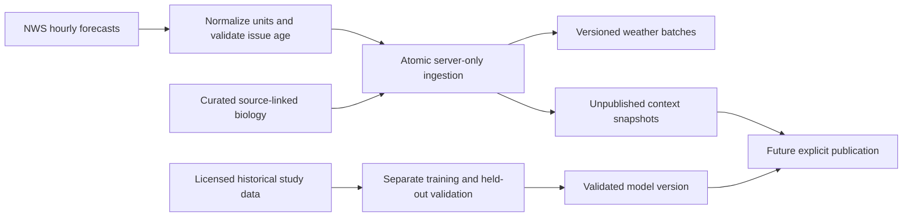

# Deer and turkey forecasting: sources and infrastructure

Research and local implementation: November 16, 2026. This is an additive foundation for the existing BlindIQ app, not a release of validated animal predictions. The hosted database, existing duck pipeline and live app have not been changed.

## What is already implemented locally

- A CLI-generated Supabase migration with eight new tables: source registry, pilot regions, sourced knowledge, model versions, source runs, normalized weather batches, draft snapshots and optional private field observations.
- Sixteen source records with access method, rights status, refresh cadence, checked date and limitations. Only NWS is enabled for automatic ingestion. Research pages are citations/manual curation; datasets with unresolved terms remain disabled or manual-review candidates.
- Two representative pilot points: Maryland whitetail and South Carolina lower-coastal Eastern wild turkey research context. These are not statewide weather averages or parcel-level forecasts.
- A Node 22 weather worker using the same NWS points/hourly approach as Migration Pulse. It defaults to a dry run. Explicit server-side write mode creates health logs and uses one transactional RPC per region to persist normalized data and draft context. Retries of identical data reuse a snapshot; region locks prevent an older issue overwriting a newer one.
- RLS and explicit grants. Raw weather, source health and research curation stay server-only. Signed-in clients can read active pilot metadata and only explicitly published, unexpired snapshots. New snapshots default to unpublished. Numeric activity scores require a separately validated model with a validation-report URL.
- Optional first-party observations have owner-based access, effort minutes, zero-sighting support, species/region matching and default training opt-out. No existing hunt logs are imported, no exact coordinates are collected, and no observation UI is added yet.

## Difference from the existing duck system

`supabase/functions/migration-refresh/index.ts` currently fetches NWS hourly forecasts and applies BlindIQ seasonal/wind rules. It is not a direct radar, banding, eBird or live bird-location ingestion system. Reuse the source/run/snapshot pattern, not its duck score or flyway regions. Deer breeding timing, deer movement, turkey gobbling and turkey movement are separate modeling targets.

## Priority public sources

| Source | Role | Access and limitations |
| --- | --- | --- |
| [NWS hourly API](https://www.weather.gov/documentation/services-web-api) | Live environmental inputs for both species | API, identifying User-Agent required. [NWS data-use guidance](https://www.weather.gov/disclaimer) allows use of public-domain material subject to stated conditions. Current adapter extracts temperature, wind and precipitation probability, not barometric pressure. |
| [Maryland DNR whitetail biology](https://dnr.maryland.gov/wildlife/Pages/hunt_trap/wtdeerbiology.aspx) | Regional breeding context for the first deer pilot | Manual sourced summary. A breeding interval is not a daily activity prediction; whitetail information must not be applied to sika or Sitka. |
| [MDWFP deer breeding map](https://www.mdwfp.com/wildlife-hunting/wildlife-species-program/deer-program/deer-breeding-date-map) | Regional conception timing for a later Mississippi pilot | Study-derived map, not a live feed. Preserve regional differences and distinguish conception dates from observable rut activity. Review GIS availability and reuse terms before automated extraction. |
| [Mississippi State buck movement research](https://extension.msstate.edu/publications/understanding-buck-movement-how-when-and-why-bucks-navigate-the-landscape) | Candidate deer features and scientific interpretation | Research synthesis; do not invent numerical coefficients from the article or apply Mississippi calendar dates nationally. |
| [Pennsylvania Game Commission rut research](https://www.pa.gov/agencies/pgc/wildlife/discover-pa-wildlife/white-tailed-deer/when-is-the-rut) | A northern-state biological reference | Curate independently from southern rut regions; avoid a single nationwide rut date. |
| [USDA turkey gobbling/weather study](https://research.fs.usda.gov/treesearch/64503) | Evidence for a turkey vocalization model | Southeastern Eastern wild turkey acoustic research. Weather associations are not already-calibrated BlindIQ coefficients and gobbling does not directly measure movement or hunting success. |
| [Dryad gobbling/weather data](https://doi.org/10.5061/dryad.573n5tb9k) | Highest-priority turkey training candidate | Published CSV contains daily gobble counts, recording-unit effort and weather variables. Historical 2014–2018 study data, not a live sensor feed. [Dryad terms](https://datadryad.org/terms) publish research datasets under CC0; keep dataset/version citation and inspect README before import. Direct file downloads returned HTTP 403 in this environment, so no raw dataset was imported. |
| [Dryad male turkey GPS tracks](https://doi.org/10.5061/dryad.rv15dv4fb) | A distinct turkey movement target | Historical 2020–2021 GPS files; inspect sex, study site, fix quality, missing values and timestamps. Split validation by animal/site, not adjacent GPS rows. Registered as a manual candidate, not acquired or ingested. |
| [Dryad southern Illinois whitetail GPS](https://doi.org/10.5061/dryad.51c59zwr4) | Deer movement/habitat training candidate | Research tracks from 125 deer across three sites during 2023–2025. Road-encounter study design limits generalization. Study coordinates are research records, not user locations or current animal locations. Candidate only; not imported. |
| [SCDNR turkey research](https://www.dnr.sc.gov/wildlife/turkey/pdf/2018SCDNRTurkeyReporttoGeneralAssembly.pdf) | Local reproductive and gobbling context | Lower-coastal research does not establish dates for all South Carolina terrain or other regions. Manual curation. |
| [SCDNR annual harvest report](https://www.dnr.sc.gov/wildlife/turkey/2025TurkeyHarvest.html) | Effort, population and seasonal context | Annual reporting and survey biases; harvest totals are not a real-time activity measure. |
| [USGS Annual NLCD](https://www.usgs.gov/centers/eros/science/annual-nlcd-data-access) | Forest, edge, agriculture and habitat covariates | Public-domain land-cover products; record product/version/resolution and delivery terms. Habitat information is not a direct movement observation. |
| [USA-NPN data services](https://www.usanpn.org/data/code) | Green-up and spring-phenology candidate | API and derived products. Verify product-specific license, issue dates, spatial coverage and lag before enabling. Not an animal activity signal by itself. |
| [NOAA NCEI CDO v2](https://www.ncei.noaa.gov/cdo-web/webservices/v2) | Historical weather to align with animal research | Requires an API token; review station/product coverage, units and time handling. Not yet implemented. |
| [Movebank access](https://www.movebank.org/cms/movebank-content/access-data) | Discover additional research telemetry | Owners set study access and [license terms](https://www.movebank.org/cms/movebank-content/data-policy); some studies require permission or accepting a study license. No permission requests sent or licenses accepted. |
| [eBird API terms](https://www.birds.cornell.edu/home/ebird-api-terms-of-use/) | Potential turkey occurrence/effort supplement | Commercial use needs permission. Disabled for BlindIQ until permission is obtained; public access is not sufficient. Occurrence is also not a gobbling or movement rate. |

## Database and ingestion flow



The source registry and knowledge are separate from measurements. Retain source URLs, issue time, fetch time, forecast validity, checksum, missing fields and model version. Weather forecasts are labeled forecasts; they are never described as animal observations. Missing values remain null. Availability is not a numerical confidence score.

## Run and verify

Use the repository's Node 22 / pnpm configuration. The only new dependency is pinned development-only `@electric-sql/pglite@0.5.16`; app runtime dependencies are unchanged.

```sh
pnpm install --frozen-lockfile
pnpm test
pnpm test:forecast
NWS_USER_AGENT='BlindIQ (a monitored contact address)' pnpm forecast:dry-run
```

For database writes, apply the new migration to a staging database after comparing its migration history. The new worker is a server job, not a browser module or deployed Edge Function. Set SUPABASE_URL, server-only SUPABASE_SECRET_KEY and NWS_USER_AGENT in a server secret store, then run:

```sh
node scripts/forecast-refresh.mjs --write
```

The secret is sent on the API's `apikey` header, never bundled in Vite. This does not publish snapshots or change the duck updater. Worker write mode reads at most ten active pilot points per invocation. No production writes, cron schedules, user messages, key registrations or vendor purchases were performed here. Hosted scheduling/secret configuration, model publication and frontend integration remain future deployment steps.

Start with an hourly staging job. Alert on stale running jobs, failed/partial runs, NWS issue age and missing values. Keep a previous fresh snapshot only until its original expiry; never advance freshness after upstream failure. Consider caching NWS point metadata, conditional requests and per-source budgets before scaling beyond pilots. Add retention/cleanup policies before sustained production ingestion; this foundation does not schedule deletion or prune records automatically.

Supabase CLI 3.1.0 generated the migration. CLI v3 is local by default and changes hosted-command flags; follow current help and [v3 migration guidance](https://supabase.com/changelog/supabase-cli-v3) instead of blindly running older deployment snippets. Apply only the reviewed migration after history comparison, run staging queries and hosted advisors, then deploy/schedule the worker. No hosted advisors were run because no hosted schema was changed.

## Validation performed

- 25 existing regulation/logger tests plus 16 new forecasting tests pass (41 Node tests reported in total). Test environment: Node 24.22.1 / pnpm 11.25.0; the repository continues to declare Node 22 / pnpm 10.28.0. Frozen lockfile validation passes; installed dependencies were not destructively purged.
- The migration executes against embedded PostgreSQL (PGlite), with simulated Supabase roles/auth.uid. Tests exercise real grants, RLS, ownership, unpublished/expired visibility, invalid scoring, duplicate/stale input rejection, source disabling, transaction idempotency and source-seed consistency.
- Schema checks verify all eight new tables have RLS and both privileged ingestion/guard functions are security invoker. This is not a complete hosted Supabase/REST/cron integration test.
- TypeScript and production Vite build pass; the full package includes the current hunting hub and IQ branding. Existing large-bundle advisory remains.
- Live NWS dry run: South Carolina returned 48 usable forecast hours; Maryland was rejected as stale. Region failures are isolated. No database write occurred during that dry run.
- Dryad landing-page metadata and terms were accessible; direct file downloads returned HTTP 403. Datasets remain candidates rather than silently substituted or imported data.

## Next modeling work

First acquire and inspect the gobbling CSV and the two telemetry datasets with citations, checksums and archived README. Align historical weather by date/site and measurement effort. Turkey training should model gobbles per recorder effort independently from GPS-derived movement. For deer, derive activity from valid consecutive fixes and apply region-specific reproductive context. Hold out animals, sites and years; compare against seasonal and time-of-day baselines, and document calibration and transfer limits before publishing scores.

BlindIQ's current Saw counts lack per-observation timestamps, session duration and recorder effort, and can include repeat sightings. Do not treat them as effort-corrected training labels. The optional private observation table is preparation for a future explicit observation/consent flow, not permission to repurpose existing users' logs. No moon-based or cold-front activity formula has been invented in this foundation.
